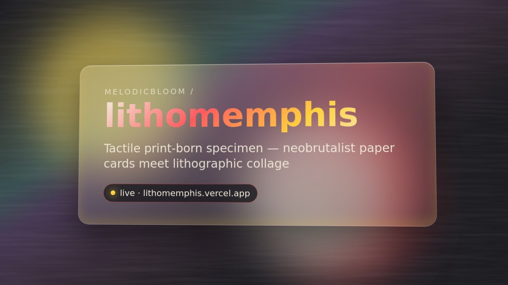

# Lithomemphis — Specimen Runtime

**A tactile, print-born design specimen: neobrutalist paper cards, brass clips and lithographic collage, rendered as a static two-route web runtime.**

Live: https://lithomemphis.vercel.app

> Specimen / demo only. There are no accounts, votes, challenges, leaderboards or live community metrics. Studio names and artifacts are fictional sample content (`src/data/artifacts.json`). Metric tiles show "—".

## Routes
- `/` — Collective home specimen: static hero prompt card ("Print the Future"), sample featured studios (no scores), metric placeholders, archive strip.
- `/gallery` — Gallery with taxonomy sidebar, tab filters, search, and grid/list toggle over static JSON.

## Palette (`src/index.css` CSS vars + `src/tokens.ts`)
| Token | Hex |
|---|---|
| `--ink` | `#0E0E0E` |
| `--paper` | `#F7F6F2` |
| `--cornflower` | `#3B6FF0` |
| `--sunflower` | `#EABF41` |
| `--cherry` | `#D54545` |
| `--lime` | `#9BBF49` |
| `--mauve` | `#9B5478` |
| `--wine` | `#58294B` |

Also exposed as Tailwind colors (`bg-ink`, `text-cornflower`, …).

## Type substitution
Comps use Canela Deck (display) and Noe Display (serif). Free substitutes via Google Fonts:
- Canela → **Fraunces** (900, opsz) for display headlines
- Noe → **Instrument Serif** for editorial serif titles
- UI/mono → **Space Mono**; body → **Inter**

## Art direction
All imagery is original inline SVG/CSS: marble = layered gradients, halftone = radial-dot patterns, botanicals = generated SVG petal geometry, brass clips = clipped gradient corners. No stock or comp assets are reused.

## Stack
Vite + React + TypeScript + Tailwind v4 + react-router. `npm i && npm run dev`.

## Wave 2 — specimen pages built
- `/gallery` functional tag/medium/year/search filters (URL params) + `/gallery/:id` artifact detail pages
- `/archive`, `/community`, `/shop`, `/about` — specimen pages with fictional content (no auth, no checkout, no challenges, metrics “—”)

## Wave 2 — NOT built yet
- Accounts/auth, profiles, XP/badges
- Challenges (submission, voting, timers), leaderboard computation
- Live activity feed ("The Collective is listening"), comments
- Mobile nav drawer from the mobile comp; dark "Tool Lab" / "Challenge Arena" templates
- Real 3D marble object, photographic collage

## Visual proof

[](https://lithomemphis.vercel.app)

[](docs/visual-proof/hero.mp4)

Poster links to an 8 s hero loop (`docs/visual-proof/hero.mp4`); social card at `docs/visual-proof/og.png`. Generated with [visual-proof-kit](https://github.com/MelodicBloom/visual-proof-kit).

Lighthouse: run locally — `npx lighthouse https://lithomemphis.vercel.app --view`

## Lab (`/lab`) — live pick board
21 working effect/interaction demos. Toggle each on/off, open it in a dialog, and ☆ pick; picks persist in localStorage (“copy picks” gives you a comma list). The ☀ LIGHT slider changes `--lm-angle` (seeded from the `light.angle` token) for every lit card. Icon browser: `/lab/icons`. Experimental stamp → bleed → relief plate: `/lab/press-cycle` (also `/lab#press-cycle`). It is a DEFER specimen with illustrative units, not a calibrated press and not a `/portico` route. `/` and `/gallery` are unchanged.

Components (`src/components/`): `SpringPressable`, `Magnetic`, `GrainMask`, `BackdropSurface`, `LithoCard`, `OfferChip`, `ShaderCanvas`, `Icon` + `InkDefs` (12 stamp icons, finishes `clean|bleed|stamp`), and `ui/` (Button, Switch, Tabs, Dialog). These are small local primitives in the style of shadcn (variant props, native `<dialog closedby>`). They use the litho tokens, not shadcn's gray theme. Spring physics: `src/lib/spring.ts` (semi-implicit Euler; snaps under reduced motion / safe mode).

Modern CSS used: `backdrop-filter` with `isolation:isolate` plus an `@supports not` color-mix fallback, `color-mix()`, `@container`, View Transitions (feature-detected, skipped under reduced motion), `animation-timeline: view()` with an IntersectionObserver fallback, `@starting-style` dialog entry, and per-rule `prefers-reduced-motion` (no global 0.01ms hack).

## Storybook
```
npm run storybook          # dev at http://localhost:6006
npm run build-storybook    # static → storybook-static/
```
On deploy, `npm run build:all` also builds Storybook into `dist/storybook`, so it's served at **`/storybook`** on the same Vercel URL.

## Design tokens & drift audit
- Source of truth: `tokens/{color,space,spring,backdrop,light}.json`
- Schema: `schema/token-drift.schema.json` (JSON Schema 2020-12: hex colors, px spacing, spring ranges, backdrop/light shapes)
- `npm run tokens:sync` regenerates `src/styles/tokens.css` (`--lm-<set>-<key>[-<sub>]`). Don't hand-edit that file.
- `npm run tokens:audit` validates the token files against the schema, then checks 1:1 parity with the CSS vars (missing, value mismatch, orphan var). It writes **`token-audit-receipt.json`** and exits non-zero on any drift. `npm run build` runs it first, so a drifted token fails the deploy.

### How Q&A stays auditable
Each audit leaves a receipt with `pass`, `auditedAt`, `commit`, `tokensHash`, counts, and the exact `drifted[]` keys (expected vs actual). A reviewer answers "did tokens change, and are they still consistent?" by diffing receipts across commits: a `tokensHash` change means the tokens changed, and `drifted[]` names each key that went wrong. The `/lab` header shows the live receipt chip (PASS/FAIL · token count).
