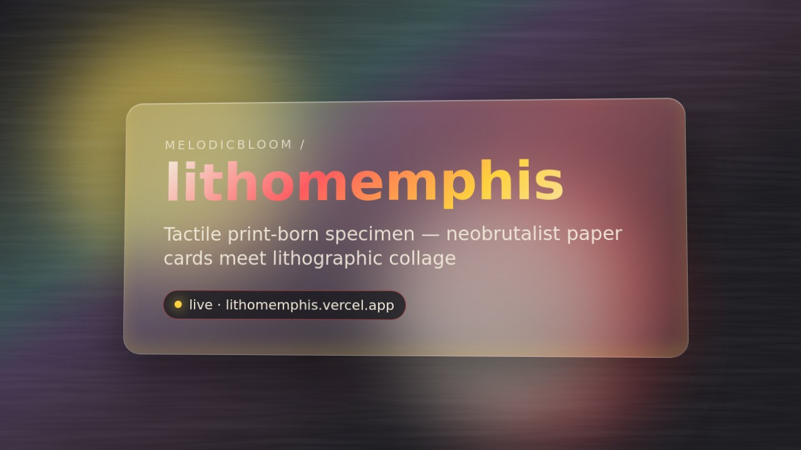

# Lithomemphis — Specimen Runtime

**A tactile, print-born design specimen: neobrutalist paper cards, brass clips and lithographic collage, rendered as a static two-route web runtime.**

Live: https://lithomemphis.vercel.app

> Specimen / demo only. There are no accounts, votes, challenges, leaderboards or live community metrics. Studio names and artifacts are fictional sample content (`src/data/artifacts.json`). Metric tiles show "—".

## Routes
- `/` — Collective home specimen: static hero prompt card ("Print the Future"), sample featured studios (no scores), metric placeholders, archive strip.
- `/gallery` — Gallery with taxonomy sidebar, tab filters, search, and grid/list toggle over static JSON.

## Palette (`src/index.css` CSS vars + `src/tokens.ts`)
| Token | Hex |
|---|---|
| `--ink` | `#0E0E0E` |
| `--paper` | `#F7F6F2` |
| `--cornflower` | `#3B6FF0` |
| `--sunflower` | `#EABF41` |
| `--cherry` | `#D54545` |
| `--lime` | `#9BBF49` |
| `--mauve` | `#9B5478` |
| `--wine` | `#58294B` |

Also exposed as Tailwind colors (`bg-ink`, `text-cornflower`, …).

## Type substitution
Comps use Canela Deck (display) and Noe Display (serif). Free substitutes via Google Fonts:
- Canela → **Fraunces** (900, opsz) for display headlines
- Noe → **Instrument Serif** for editorial serif titles
- UI/mono → **Space Mono**; body → **Inter**

## Art direction
All imagery is original inline SVG/CSS: marble = layered gradients, halftone = radial-dot patterns, botanicals = generated SVG petal geometry, brass clips = clipped gradient corners. No stock or comp assets are reused.

## Stack
Vite + React + TypeScript + Tailwind v4 + react-router. `npm i && npm run dev`.

## Wave 2 — NOT built yet
- Accounts/auth, profiles, XP/badges
- Challenges (submission, voting, timers), leaderboard computation
- Live activity feed ("The Collective is listening"), comments
- Archive / Community / Shop / About routes (shown disabled)
- Artifact detail pages; functional tag/medium/year filters
- Mobile nav drawer from the mobile comp; dark "Tool Lab" / "Challenge Arena" templates
- Real 3D marble object, photographic collage

## Visual proof

Poster links to an 8 s hero loop (`docs/visual-proof/hero.mp4`); social card at `docs/visual-proof/og.png`. Generated with [visual-proof-kit](https://github.com/MelodicBloom/visual-proof-kit).

Lighthouse: run locally — `npx lighthouse https://lithomemphis.vercel.app --view`
